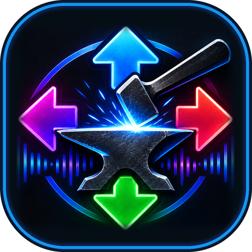
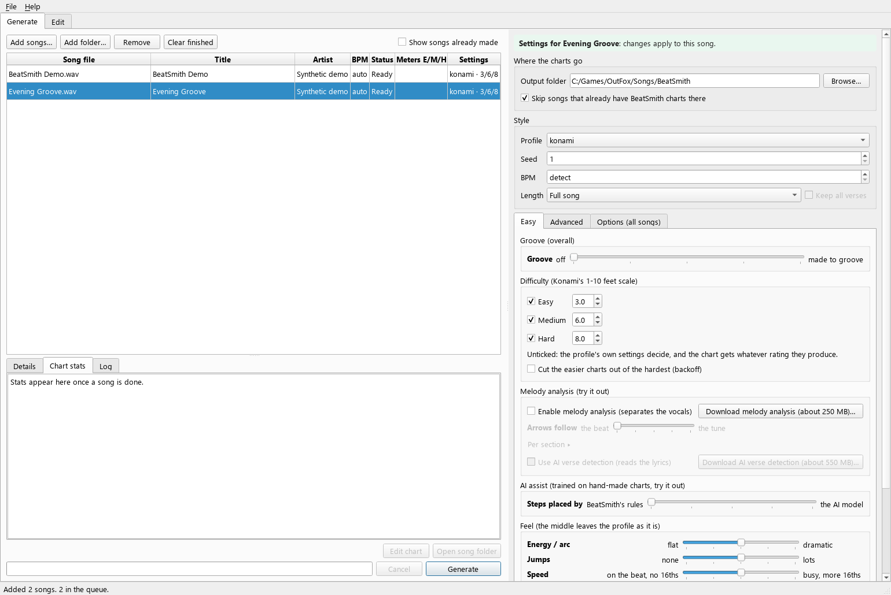
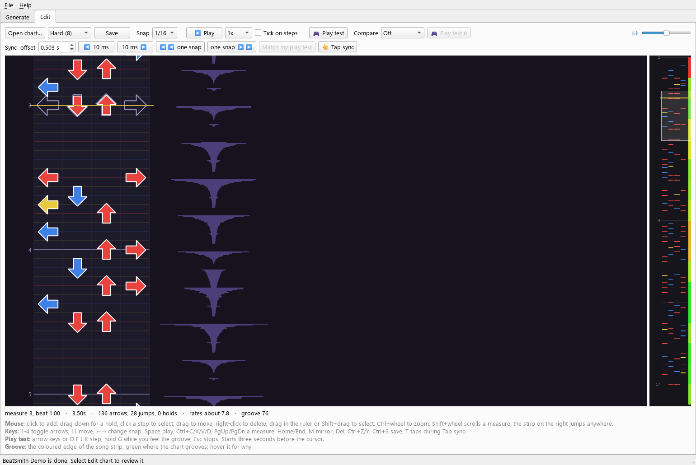

<p align="center"></p>

# BeatSmith

Turn a song into Easy, Medium and Hard four-panel dance charts for
**StepMania, ITGmania and OutFox**. Make charts, adjust their feel, then
review and play-test them in the built-in editor.

[Download the app](https://github.com/paul-lapczynski/beatsmith/releases/latest) ·
[App guide](docs/APP_GUIDE.md) · [AI Usage](AI_USAGE.md) ·
[Control reference](docs/DIALS.md) · [Command line](docs/COMMAND_LINE.md)



*Windows app screenshot using synthetic demo content. No personal music library
or copyrighted song is shown. The [app guide](docs/APP_GUIDE.md) has the full tour.*

## Install

Download an installer from the [latest release](https://github.com/paul-lapczynski/beatsmith/releases/latest).

| Computer | Download |
|---|---|
| Windows 64-bit | The `.msi` or `-setup-….exe` installer; choose one |
| Mac with Apple Silicon | The `-mac.dmg` disk image |

The packaged app includes its Python runtime. You do not need to install
Python separately. Optional AI add-ons are downloaded from inside the app.

On Windows, use the same installer type when upgrading. If switching between
EXE and MSI, uninstall the old copy first. If two BeatSmith entries are
installed, remove both before installing one current copy. The new Windows
uninstallers remove downloaded add-ons; songs and settings are kept.

The app is not code-signed. Windows may show SmartScreen's publisher warning;
macOS may require **System Settings → Privacy & Security → Open Anyway**.
Use the official release download. See the [installation guide](docs/APP_GUIDE.md#install-and-update)
for details and older-install recovery.

<a id="quick-start"></a>

## Make your first chart

1. Open BeatSmith and choose **Add songs…**, or drag in an audio file.
2. Choose an **Output folder** inside your rhythm game's `Songs` folder,
   such as `OutFox/Songs/BeatSmith`. Each song gets its own folder there.
3. Select the queued song. Leave **BPM** on **detect** unless you know the tempo.
4. Start with the **konami** profile and difficulty targets **3 / 6 / 8**,
   or pick levels comfortable for you. Optional AI controls can stay off.
5. Press **Generate**. Select the finished song to see its stats and log.
6. Press **Edit chart** to check the notes, timing and play feel. Save any edits.
7. Reload songs in StepMania, ITGmania or OutFox and play the result.

Settings belong to the selected songs. With nothing selected, the panel sets
defaults for songs you add next. Finished songs show their saved settings;
**Change settings and regenerate** unlocks them for another run.

## What is included

- **Queue and per-song settings:** process several songs, keep each song's settings,
  and return to charts already made.
- **Difficulty and feel:** targets for each chart, profiles, Groove, energy,
  jumps, speed, breathing room, footwork, holds and repetition.
- **Chart editor:** waveform, note editing, holds, undo, keyboard play tests,
  timing adjustments and another chart shown alongside yours.
- **Optional AI:** local step-placement assistance, vocal separation and
  lyric-based verse detection. [AI Usage](AI_USAGE.md) explains the data flow.
- **Song artwork:** use embedded or nearby cover art, with online lookup only
  when enabled.
- **Shorten and backoff:** try a shorter song cut, or reduce easier charts
  from the hardest chart's steps.



## AI Usage

BeatSmith uses conventional audio analysis and charting rules, with optional
local AI features. Normal app generation does **not** upload song audio to a
cloud AI service or require a cloud API key. Downloads and optional artwork
lookups use the internet. A separate, unfinished command-line review tool
can send chart summaries to a cloud provider when explicitly run.

AI tools, including Claude and OpenAI Codex, have also assisted development,
debugging, tests and documentation. See [AI Usage](AI_USAGE.md) for the
feature-by-feature disclosure, external services and limitations.

## Know the limits

Generated charts are a starting point: listen, edit and play-test them.
The difficulty number and Groove score are estimates, not guarantees of
musical accuracy or playability.

BeatSmith generates a single constant BPM per song. Tempo changes and live
recordings can drift. The bar start can be wrong, triplets and mines are not
generated, and the experimental melody control follows onset/brightness
cues rather than a note-for-note musical transcription. There is no dedicated
lead-instrument mode in the released app.

Use music you have permission to use. BeatSmith does not provide a song library.

## More documentation

| Guide | Use it for |
|---|---|
| [App guide](docs/APP_GUIDE.md) | Installation, queue, controls, editor, timing, files and troubleshooting |
| [AI Usage](AI_USAGE.md) | What uses AI, local versus online processing, downloads and development disclosure |
| [Control reference](docs/DIALS.md) | Detailed slider behavior and the earlier dial measurements |
| [Interactive dial preview](https://paul-lapczynski.github.io/beatsmith/preview.html) | Compare what the controls do visually |
| [Command-line reference](docs/COMMAND_LINE.md) | Run from source, generation options, profiles and review tools |
| [Repository layout](docs/REPOSITORY_LAYOUT.md) | Current code/tool/test organization and compatibility commands |
| [Cleanup plan](docs/REPOSITORY_PLAN.md) | Staged migration approach and validation gates |
| [Installer builds](packaging/BUILD.md) | Build Windows and Mac packages |
| [Releasing](packaging/RELEASING.md) | Maintainer release automation and recovery |

## Run from source

The release installers are the easiest way to use the app. For development,
use Python 3.12 (also used by the package builds):

```sh
python -m pip install -r requirements.txt -r requirements-app.txt
python beatsmith_app.py
```

On Windows, `run_app.bat` also launches the source app. See the
[command-line reference](docs/COMMAND_LINE.md) for generation without the GUI.

Free and open source under the [MIT license](LICENSE). StepMania, ITGmania
and OutFox are independent projects; BeatSmith writes chart files they can read.
