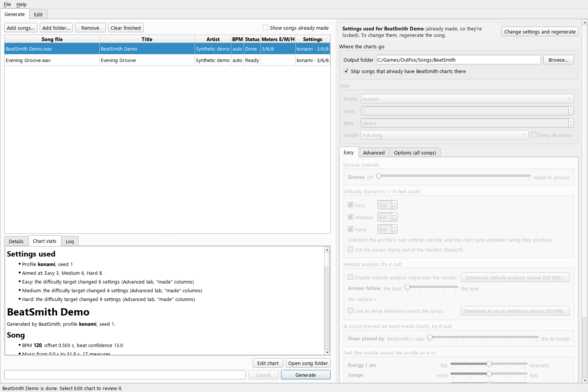
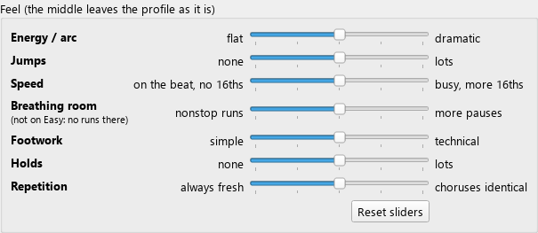
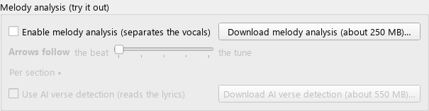
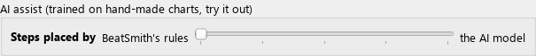
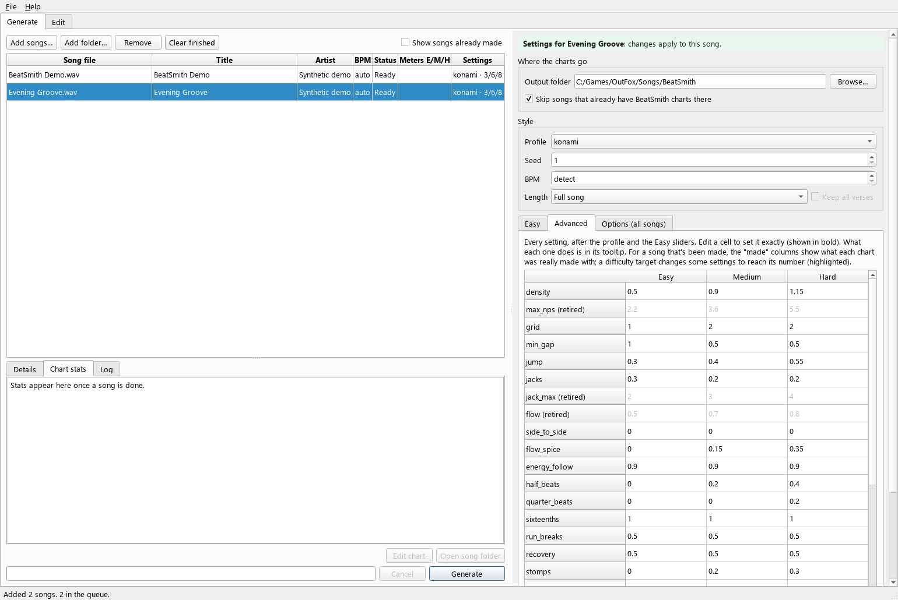
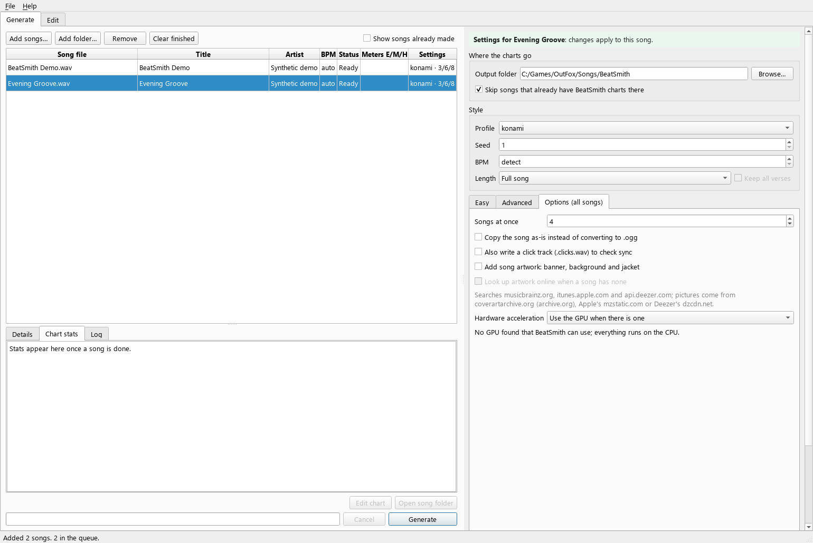
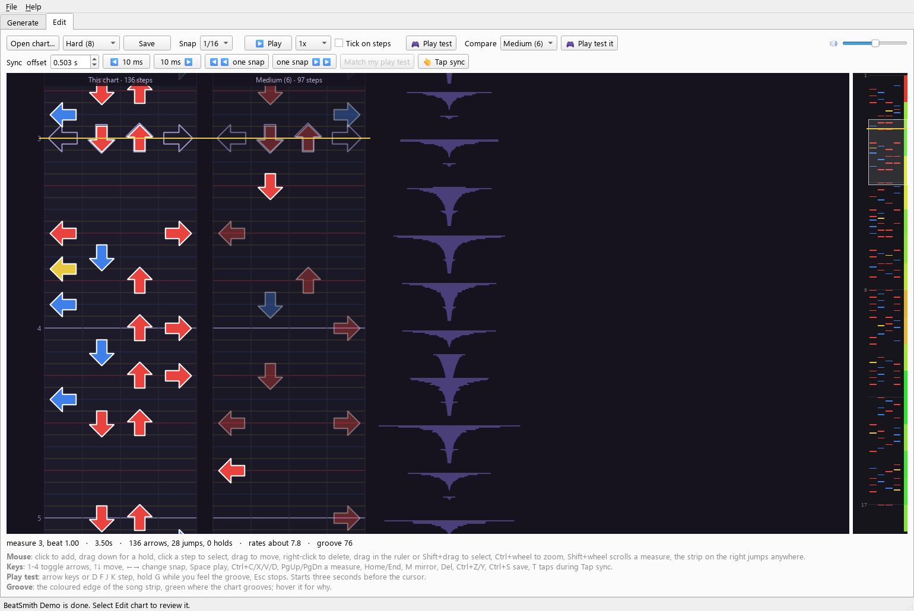

# BeatSmith app guide

[Home](../README.md) · [AI Usage](../AI_USAGE.md) · [Control reference](DIALS.md) · [Command line](COMMAND_LINE.md)

BeatSmith makes four-panel dance charts from your audio, then gives you an
editor to check and improve them. This guide follows the released app.
Screenshots show the Windows interface with synthetic demo content; Mac
window styling may differ. Click a screenshot to view it at full size.

## Install and update

Get the app from the [latest GitHub release](https://github.com/paul-lapczynski/beatsmith/releases/latest).
Windows uses the `.msi` or setup `.exe`; choose one. The Mac disk image is
for Apple Silicon. The packaged app includes its own Python runtime.

On Windows, keep the same installer type for updates. The MSI cannot upgrade
an EXE installation. Uninstall the old copy before changing installer type;
if both appear in **Settings → Apps**, remove both, then install one current
copy. This avoids mixing incompatible runtime files. Recent Windows
uninstallers remove downloaded add-ons, so switching installer types can
require downloading them again. Your songs and saved settings are kept.

The app is unsigned. Windows may show a SmartScreen publisher warning.
On macOS, if opening is blocked, check **System Settings → Privacy & Security →
Open Anyway**. Use the official release files.

An installer's **Clean install** option is different from uninstalling:
on first launch it resets remembered settings, window layout and saved
profiles, while keeping generated songs, song data and downloaded add-ons.

## Make a first song

1. Choose **Add songs…**, **Add folder…**, or drop audio files onto the window.
2. Pick an **Output folder** inside your game's `Songs` folder. For example,
   `OutFox/Songs/BeatSmith` is a group containing a folder for each song.
3. Select a queue row. Check its title, artist and BPM; **auto/detect** is a
   good starting point for BPM.
4. Start with the **konami** profile and suitable difficulty targets.
   **3 / 6 / 8** is the app's starting set, not a required skill level.
5. Press **Generate**. A finished song shows **Done** and the resulting
   Easy/Medium/Hard meters. Read **Chart stats** or **Log** for what happened.
6. Choose **Edit chart**, listen and play-test. Save any edits.
7. Reload songs in StepMania, ITGmania or OutFox. Find the output group and play.

The source song stays where it was. The output song folder contains the
chart, playable audio and optional pictures. Analysis and saved settings go
in BeatSmith's own data folder.

## Understand the queue

The message above the settings panel says whose settings you are changing.

| Selection | What your changes affect |
|---|---|
| No song selected | Defaults for songs you add next |
| One waiting song | That song only |
| Several waiting songs | All selected songs |
| A finished or currently running song | Settings are locked and show what was used |

To change a finished song, select **Change settings and regenerate**, make
your changes, then press **Generate**. This replaces its generated charts;
keep a copy first if you want to preserve hand edits. **Skip songs that
already have BeatSmith charts there** avoids redoing existing output.

**Show songs already made** lists earlier output. Select a row to open it in
the editor or inspect its saved settings. Regeneration also needs the source
audio to remain available.

## Choose difficulty and feel

**Easy** is the settings tab's name; it contains controls for all three
chart difficulties. Each checked target asks for a meter on the app's
rough 1–10 feet scale. An unchecked target uses the profile's own settings.
The final meter is an estimate of the result, so it can differ from the
requested number. Targets of 9 or 10 may push beyond the feel sliders;
the app's warning and stats explain what changed.

**Profile** chooses the starting style. **Seed** changes the generated
arrangement without changing the source song. **Groove** adjusts several
feel settings together; higher values also try more candidate charts and
can take longer. The individual Feel sliders are applied afterward.

| Control | Main effect |
|---|---|
| Energy / arc | More contrast between quieter and busier parts |
| Jumps | More or fewer two-arrow hits |
| Speed | More or fewer off-beat runs and short bursts |
| Breathing room | Pauses and recovery around busy runs |
| Footwork | Simpler or more technical arrow patterns |
| Holds | More or fewer freeze arrows |
| Repetition | More reuse when musical sections repeat |

The middle of a Feel slider leaves the selected profile as written. For
details and earlier measurements, see the [control reference](DIALS.md).
Scrolling over form controls scrolls the page without changing their values;
click, type, use arrow keys or drag a slider to make a deliberate change.

**Cut the easier charts out of the hardest (backoff)** makes the hardest
chart first, then reduces it for the other difficulties. This helps players
on different difficulties share the same rhythm. Without it, difficulties
are generated independently.

## Optional melody analysis and AI

**Enable melody analysis** needs the vocal-separation add-on. If it is not
available, the app offers the download and shows its sources. The **Arrows
follow** slider favors the singing/tonal onset signals instead of the
drum-led mix. **Per section** lets you override the automatic section values.
This is experimental; it is not exact musical transcription and there is
no released Lead instrument selector.

**Use AI verse detection** needs the additional verse-detection download.
It reads the separated vocals and uses repeated words to help label verses
and choruses. Misheard words can produce incorrect section labels.

**AI assist** is a separate local step-placement model. At zero, placement
uses BeatSmith's rules. Increasing it gives the model more influence;
difficulty and feel controls still apply. It does not need a cloud API key.

See [AI Usage](../AI_USAGE.md) for local processing, downloads, online
artwork, the separate cloud-review experiment and development disclosure.

## Advanced and options

**Advanced** shows the settings after the profile and Easy controls. Edit a
cell for an exact per-difficulty override; hover its name for help. Some
retired controls are gray. **Clear exact settings** removes your overrides.
For completed songs, the **made** columns show values actually used when a
difficulty target adjusted the settings.

**Options (all songs)** applies across the queue: parallel jobs, keeping the
original audio format, a click track, artwork and hardware acceleration.
Fewer parallel songs use less memory. The GPU option accelerates supported
AI operations; chart arrangement itself runs on the CPU. A failing GPU path
can fall back to the CPU.

Artwork normally uses a nearby image or embedded cover. Online lookup is a
separate opt-in that sends the song's title and artist to search services.

**Length** can try a shorter cut as a separate song. Clean cuts are not
always available. **Keep all verses** requires AI verse detection in the app
so it has lyric-based verse labels.

## Edit and play-test

Open a generated song with **Edit chart**, or use **Open chart…** for an
existing `.sm` file. Choose its difficulty at the top. The waveform helps
you compare arrows with the audio; the song strip on the right jumps to
another point. The editor is an early version, so review your saved result
in the rhythm game too.

| Action | Control |
|---|---|
| Add a tap | Click an empty position, or press 1–4 at the cursor |
| Add a hold | Drag downward from an empty position |
| Select / move | Click a note; Ctrl+click adds to the selection; drag to move |
| Delete | Right-click a note or press Delete |
| Copy / cut / paste | Ctrl+C / Ctrl+X / Ctrl+V |
| Undo / redo | Ctrl+Z / Ctrl+Y |
| Mirror selection | M |
| Play / stop audio | Space or Play; choose 1x, 0.75x or 0.5x |
| Zoom | Ctrl+wheel |
| Save | Ctrl+S or Save |

**Snap** chooses the editing grid. It includes triplet grids even though the
generator does not create triplet patterns. **Tick on steps** adds a timing
tick during playback. The first save keeps the original chart as `.sm.bak`.

Choose **Play test** and use the arrow keys or **D F J K**. It starts three
seconds before the cursor; Esc stops and shows your results. A keyboard
test is useful for timing, but does not replace checking the chart on a pad.

## Compare charts and fix timing

**Compare** displays another difficulty or an available comparison version
alongside the current chart, read-only. Matching moments are dimmed; bright
steps show differences. **Play test it** tests the selected comparison.

If the whole chart is consistently early or late, use the **Sync offset**
row, **10 ms** buttons or **one snap** buttons. Offset changes affect all
difficulties in that song and are written when you save. **Tap sync** lets
you tap T against the quarter-note beat. After a keyboard test, **Match my
play test** uses your average timing; it also reflects your own input and
audio latency, so check by ear.

If timing drifts progressively, a single offset will not fix it. Check BPM
and regenerate. BeatSmith currently generates one constant BPM per song.

The **Groove** display estimates alignment, repetition, breathing, footwork
and effort. It can help compare charts; it does not prove a chart feels good.

## Files, settings and uninstalling

| Location | Contents |
|---|---|
| Your chosen output group | One folder per song, with `.sm`, playable audio and optional artwork |
| Windows app data: `%APPDATA%\BeatSmith\BeatSmith` | Song analysis, stats, saved generation settings, stems and comparison data |
| Mac app data: `~/Library/Application Support/BeatSmith/BeatSmith` | The equivalent app data |
| Windows add-ons: `%LOCALAPPDATA%\BeatSmith\addons` | Downloaded private runtime, packages and models |
| Source checkout: `song-data/` | Analysis and generation data when running from source, unless overridden |

Current Windows uninstallers remove the current user's BeatSmith add-ons
and the older `stepgen` add-on folder. They keep songs and settings outside
those folders. Other users' private folders are not scanned. Older
uninstallers retain their old behavior until updated. Same-installer updates
keep downloads. On Mac, removing the app bundle does not automatically
remove its data or add-ons; those downloads live under
`~/.local/share/BeatSmith/addons` (or the older `stepgen` location).

## Troubleshooting

| What you see | What to check |
|---|---|
| Runtime error mentioning incompatible Python DLLs | Check for overlapping EXE/MSI installs; remove both and install one current copy |
| Notes crawl while audio plays normally | Check the chart BPM; charts made with an old accidental 1 BPM override need regeneration with detect/auto |
| Melody checkbox works without a new download | A compatible add-on may already be installed from an earlier session |
| Download or generation fails | Open the selected song's Log; confirm network access for downloads and try fewer parallel jobs |
| Charts do not appear in your rhythm game | Check the output group is under that game's Songs folder and reload its song list |
| Steady early/late timing | Check Sync offset; progressive drift usually needs a BPM correction |
| Difficulty or melody feel is wrong | Reduce the target or change the controls, regenerate, then edit and play-test; automated scores are only estimates |

For source-run instructions and exact generation options, use the
[command-line reference](COMMAND_LINE.md). Report reproducible problems in
[GitHub issues](https://github.com/paul-lapczynski/beatsmith/issues).
