# What the controls do

BeatSmith has one overall control (**Groove**), seven **Feel** sliders, a **difficulty number** per chart, two ways to change where steps come from (**Arrows follow** and **AI assist**) and an **Advanced** table with every setting. This page shows what each one does to a chart: 4 bars made at 25%, 50% and 75% (Groove off/25/50/75, difficulty 3/5/7/9), plus what the dial test measured across whole songs. Each picture shows the 4 bars where its control changes the chart the same way it does over the whole song, and the numbers under each column are for the whole chart.

Try them live: **[preview.html](preview.html)** has a slider per control, the 4 bars next to the default, and the song with a tick on every step.


The pictures are the Medium chart of *BeatSmith Demo* (examples/BeatSmith Demo, a track synthesized for these docs; the difficulty picture uses Hard) with the konami profile, seed 1 and the app's default difficulty targets (Easy 3, Medium 6, Hard 8), with everything else at its default. Each column's header gives the whole chart's rating, step count, jumps and freezes.

## At a glance

| Control | What it does | Test grade |
|---|---|---|
| [Groove (overall)](#groove-overall) | Moves 11 settings toward a steadier, more danceable chart, and from about 20% makes 2-4 versions and keeps the best | **F** |
| [Energy / arc](#energy--arc) | How much the step density follows the song: flat all the way through, or busy in the loud parts and calm in the quiet ones | **A** |
| [Jumps](#jumps) | How many jumps, jump bursts at drops and jump freezes | **A** |
| [Speed](#speed) | Beat notes only, or more half-beat runs and quarter-beat (16th) notes | **C** |
| [Breathing room](#breathing-room) | Nonstop runs, or pauses inside long runs, rests after hard parts and stomps on big beats (not on Easy: no runs there) | **D** |
| [Footwork](#footwork) | Simple steps, or more Left-Right moves and rolling patterns | **C** |
| [Holds](#holds) | How many freezes | **A** |
| [Repetition](#repetition) | Choruses danced fresh each time, or the same steps when the music repeats | **A** |
| [Difficulty number](#difficulty-number) | Aims each chart at a number on Konami's 1-10 scale | **A** |
| [Arrows follow (melody)](#arrows-follow-melody) | Steps from the drums, or from the tune (in choruses most) | **D** |
| [AI assist](#ai-assist) | Who decides where the steps go: BeatSmith's rules or the AI model | **B** |

The grade is from the dial test ([how it's scored](../dialtest/REPORT.md#1-grades)): A means it clearly moves what its label says, always in the same direction, on every song, without changing other things, and keeps working with a difficulty target on.

**The order things happen in:** the profile sets every value, Groove moves its settings, the Feel sliders move theirs from there (so they have the last word), exact values from the Advanced table replace whatever the sliders made, and then the difficulty number turns density, jumps, half-beats, holds and faster notes up or down until the chart rates what you asked for. Arrows follow and AI assist work earlier, on where the music says a step could go; everything after that still applies.

## Groove (overall)

The overall control. It sits on top of the Feel sliders and moves rhythm_repeat, beat_backbone, flow, jacks, energy_follow, phrase_shape, run_breaks, recovery, stomps and rhythm_lock together. From about 20% it also makes 2 to 4 versions of each chart and keeps the one the groove meter scores best.

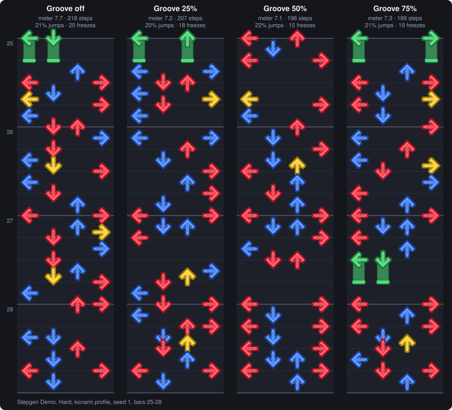

**Test grade F** (score per chart: Easy 45, Medium 41, Hard 30). On Hard: moves it 7 · same direction 33 · survives target 41 · stays in its lane 87 · every song 11 (each out of 100).

- What it really changes: more steps on the beat and fewer on half-beats, shorter runs, more stomps (on Hard with a target, 6 at Groove off to 13 at 100%), and a bigger gap between busy loud parts and calm quiet parts.
- What it doesn't change much is the groove meter itself. Hard goes from 76 with Groove off to 78 at 100%, about what changing the seed does. Either the meter doesn't reward what this slider does, or the slider needs bigger moves. That's the next thing to tune.
- It costs time: from 25% each chart is made 2-4 times (about 1 s per run with it off, 4-5 s at 75-100%).
- It makes Breathing room and Footwork work harder (their effect roughly doubles with Groove at 75%) and leaves the other Feel sliders alone.
- It pushes beat_backbone up while Speed pushes it down. With both high, Speed wins, because the Feel sliders go last.

## Energy / arc

Moves energy_follow, crescendo, phrase_shape and rest_bars.

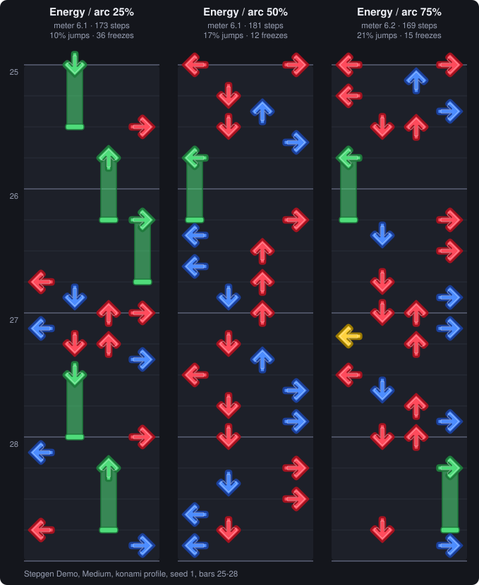

**Test grade A** (score per chart: Easy 97, Medium 81, Hard 84). On Hard: moves it 100 · same direction 85 · survives target 61 · stays in its lane 86 · every song 67 (each out of 100).

- It does what it says. With no target, the loudest quarter of bars goes from 1.4x to 3.1x the steps of the quietest quarter (25% to 75%), and steps climb through build-ups.
- With a difficulty target it keeps about half its effect: the target fills the quiet bars back in to reach the number.
- How much it can do depends on the song: on Sandstorm (big drops and breakdowns) the loud/quiet gap goes from 1.7x to 6.4x; on Yeah, which is loud all the way through, it changes almost nothing.

## Jumps

Moves jump, jump_clusters and jump_holds.

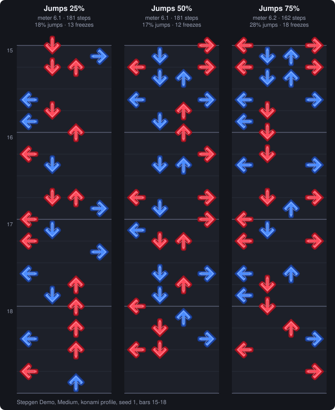

**Test grade A** (score per chart: Easy 97, Medium 90, Hard 85). On Hard: moves it 100 · same direction 95 · survives target 35 · stays in its lane 70 · every song 100 (each out of 100).

- Clear and reliable: jumps go from 7% to 18% of steps with no target, 12% to 22% with one, on every song.
- Jump freezes ([2002]) roughly double along with it.
- Side effect: more jumps means fewer single steps, so Left<->Right moves drop and the step count falls a little.
- With a target, jump is one of the settings the target turns up for harder charts, so a high Jumps setting plus a hard target stacks.

## Speed

Moves half_beats, quarter_beats, sixteenths and flow_spice up, and beat_backbone down.

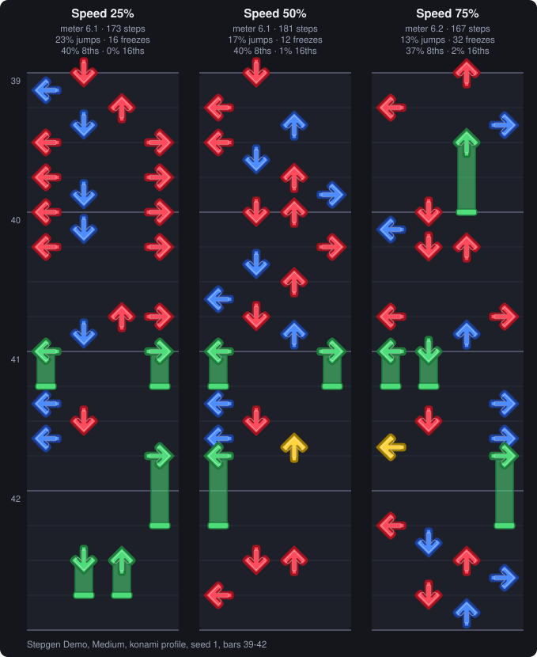

**Test grade C** (score per chart: Easy 64, Medium 73, Hard 66). On Hard: moves it 100 · same direction 48 · survives target 7 · stays in its lane 82 · every song 56 (each out of 100).

- With no target it works well: 16ths go from none to 3.8% of steps on Hard, 8ths from 26% to 45%.
- With a difficulty target, Speed now decides the 16ths: on Hard 8 they go 0%, 3.7%, 7.4%, 8.9% and 10.8% of steps from Speed 0 to 100.
- The share of 8ths is still the target's call on Hard: it needs about 40% 8ths to reach 8 on these songs, so it raises them itself when Speed starts low. Medium follows Speed only at the top (22% of steps at 0 to 43% at 100).
- That's still why its grade is a C: Speed and the difficulty number share half_beats, and the number wins when it needs them.

## Breathing room

Moves run_breaks, recovery and stomps.

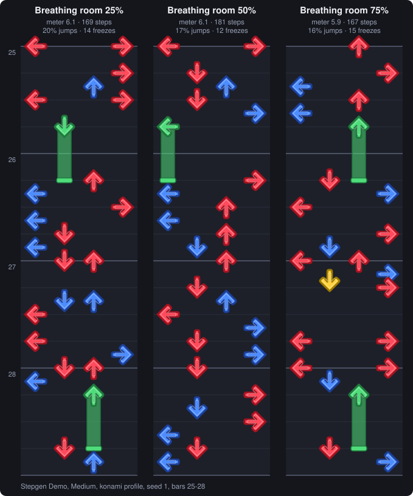

**Test grade D** (score per chart: Easy 15, Medium 50, Hard 86). On Hard: moves it 100 · same direction 83 · survives target 79 · stays in its lane 74 · every song 78 (each out of 100).

- On Medium and Hard it does what it says. With no target, runs longer than 8 steps go from about 1 a minute to none, and the average run gets shorter.
- Stomps (quarter-note jumps on a row of big beats) go from none to about 13 per Hard chart with a target. The top end no longer turns most pauses into stomps.
- It does nothing on Easy (Easy charts are beat notes with no runs to break up); the app says so next to the slider. That's most of why its grade is low.
- With a difficulty number on Hard, the number comes first. Pauses cost steps, so BeatSmith raises the density to make up for them, and if it still can't reach the number it eases Breathing room to 50% for that chart. In the test that happened to 67% of Hard charts asked for 75% or 100%, so above 50% they often look alike. The chart's stats (.stats.md, "Made with") and the app's Settings used panel say when it happens. For more pauses on a hard chart, aim a little lower (7 instead of 8) or turn the number off.

## Footwork

Moves side_to_side and jacks (down), plus flow_runs.

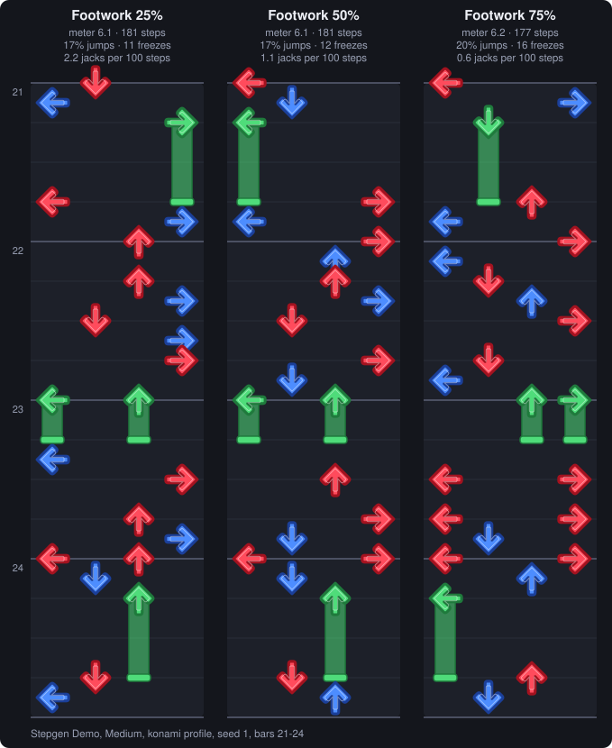

**Test grade C** (score per chart: Easy 63, Medium 75, Hard 47). On Hard: moves it 28 · same direction 47 · survives target 63 · stays in its lane 93 · every song 33 (each out of 100).

- Left<->Right and Down<->Up moves go from 13 to 23-29 per 100 steps as it rises, most of that by 50%.
- Jacks (the same arrow twice) fall as it rises: 7.4 to 2.5 per 100 steps on Easy, 5.0 to 2.0 on Medium. On Hard with a target, jacks stay around 2 whatever the setting.
- Not affected by the difficulty target on Easy and Medium.

## Holds

Moves hold_rate, hold_complexity and hold_free_foot.

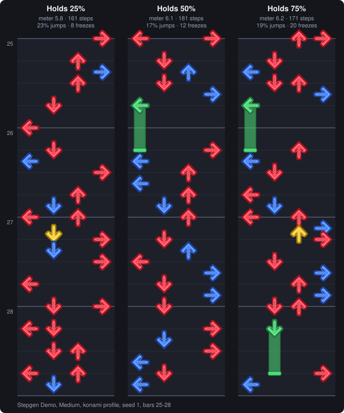

**Test grade A** (score per chart: Easy 89, Medium 90, Hard 88). On Hard: moves it 100 · same direction 100 · survives target 31 · stays in its lane 87 · every song 100 (each out of 100).

- Clear and reliable: freezes go from 6 to 13 per 100 steps with no target, and held time doubles.
- With a target it keeps about a third of its effect, because the target lowers hold_rate for harder charts.
- hold_complexity and hold_free_foot made no difference in the test, so the app has retired them (greyed out in Advanced).

## Repetition

Moves rhythm_repeat, arrow_repeat and intensity_variation (down).

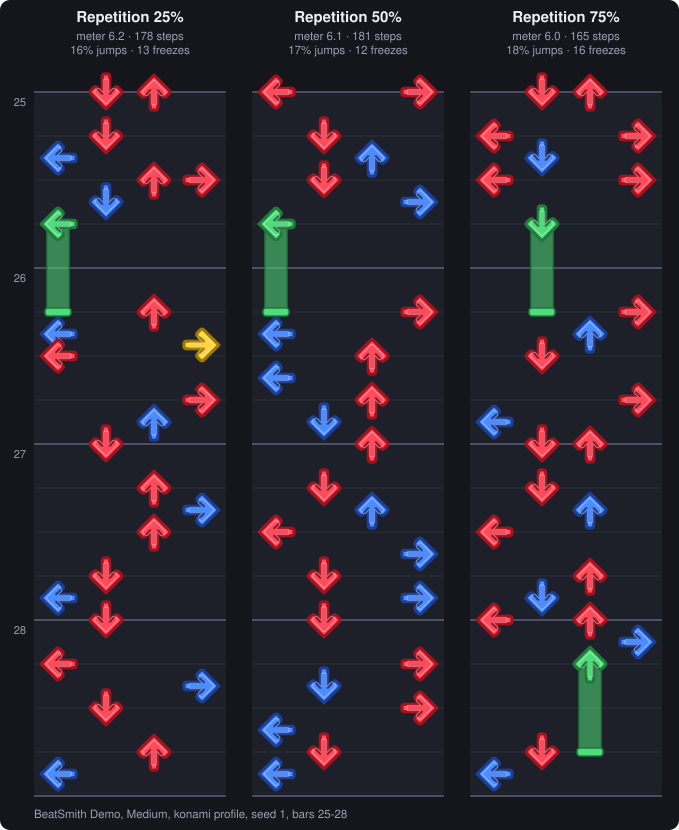

**Test grade A** (score per chart: Easy 97, Medium 97, Hard 92). On Hard: moves it 98 · same direction 95 · survives target 83 · stays in its lane 89 · every song 83 (each out of 100).

- The best-behaved slider. In repeated sections, the same rhythm goes from 75% to 84% and the same arrows from 25% to 38%, on every song, with or without a target.
- intensity_variation, one of its settings, showed no effect of its own and is retired in the app.

## Difficulty number

Each chart can be aimed at a number. BeatSmith makes the chart, rates it, and turns one intensity dial until the rating lands. In order, the dial adds steps and jumps, then 8th runs and fewer freezes, then quarter-beat bursts (above about 6), then 16th streams (8 and up). Going down, it drops to beat notes only.

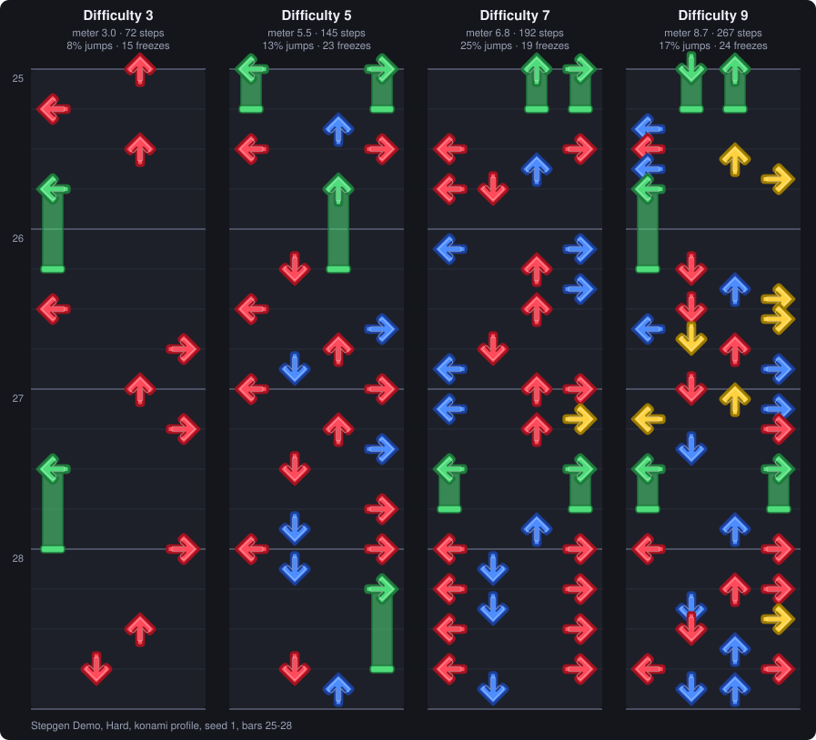

**Test grade A**: within 0.75 of the number asked 96% of the time from 2 to 8, 90% from 1 to 10.

- Very accurate: within 0.75 of the number 96% of the time from 2 to 8 and 90% from 1 to 10.
- 9 and 10 are reachable now: Hard aimed at 9 rates 9.0 and aimed at 10 rates 9.6 on these songs. The rating's top end is calibrated on Konami's own charts, so their 9s rate 9 and their 10s rate 10.
- 16ths stop at Konami's usual share (about 16% of steps at 9 and 20% at 10). Past that it makes charts harder with denser bars, longer streams and shorter rests instead.
- How a Hard chart changes from 3 to 10 (averaged over 3 songs): 1.0 to 4.1 steps a second; 16ths from 0 to 20% of steps; jumps from 8% to about 15%; freezes from 12% to 4.5% of steps.
- It decides density, jump, half_beats, quarter_beats, hold_rate, grid, min_gap and flow_spice. Before a song is made, the Advanced table shows those values before the target rewrites them; once it's made, the table's "(made)" columns show what each chart was actually made with, with the cells the target changed highlighted.
- With a target of 9 or 10 on a chart, the app warns by the Feel sliders that they may be overridden to reach it.
- The Feel sliders barely change the number when a target is on, so you can shape the feel without changing the difficulty.

## Arrows follow (melody)

Sets melody_follow. Choruses get the full amount, verses and bridges 60%, intros, outros and builds 30%.

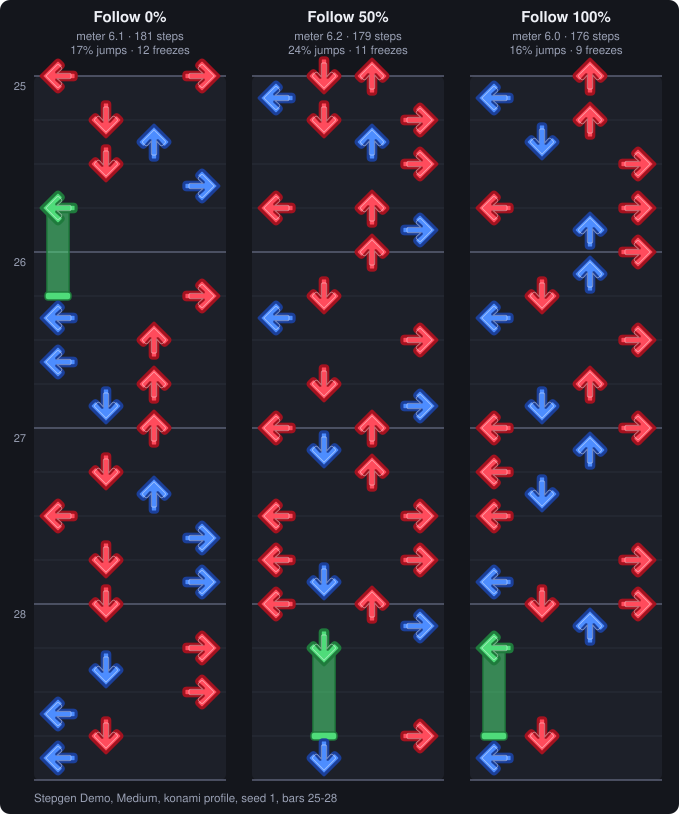

**Test grade D** (score per chart: Easy 49, Medium 48, Hard 37). On Hard: moves it 12 · same direction 50 · survives target 51 · stays in its lane 87 · every song 17 (each out of 100).

- It changes the chart: at 100%, about a third of the step positions are different from the beat-only chart.
- It needs vocal separation (stems) to do what it says. Re-tested on 4 songs with stems (dialtest/follow_stems.py): with stems, steps land more on the vocal and lead notes as Follow goes up (62.6 to 66.6 on a 0-100 scale where 50 is random, seed noise 0.4), on every song and every difficulty, most on Easy (65.7 to 71.5). Without stems it moves just as many steps, but not toward the vocal.
- The effect is modest: steps still sit mostly on the drums (about 90 on the same scale, unchanged), so it nudges the chart toward the tune rather than rebuilding it.
- Arrows rising and falling with the tune is barely measurable even with stems. BeatSmith reads the melody's brightness, not its pitch, which is a weak stand-in. Reading real pitch from the vocal stem is the likely fix.
- The Feel sliders keep working with it on. With stems, Footwork keeps its full effect at Follow 100 (the earlier full-mix test showed it losing most of it).

## AI assist

Sets ai_assist, which blends the AI model's idea of where a step belongs into BeatSmith's own.

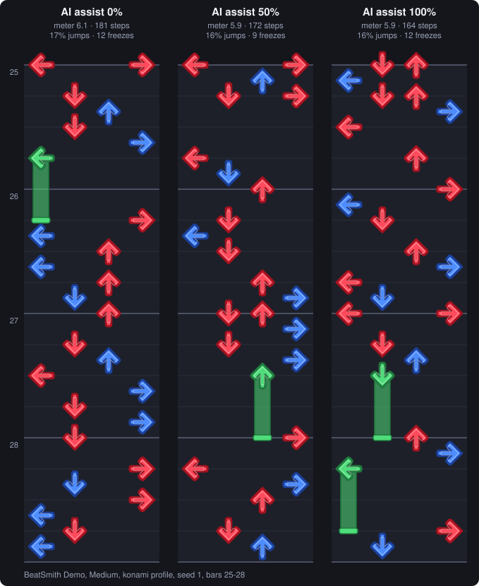

**Test grade B** (score per chart: Easy 86, Medium 78, Hard 82). On Hard: moves it 91 · same direction 80 · survives target 96 · stays in its lane 82 · every song 50 (each out of 100).

- At 100% about a third of the step positions move. The model mainly moves steps, not how many or what kind.
- BeatSmith's own steps already sit on moments the model likes (94th percentile), so there isn't much room to improve on that measure.
- The Feel sliders still rule with it on: Jumps, Holds, Footwork and Repetition keep 98-113% of their effect at AI 100, Energy and Speed about 75-80%. Breathing room drops to 40%, because the model's steps form different runs.
- Repeated sections get a little more alike (the model hears the same music the same way).

## The Advanced table

Every setting, per chart, after the profile and the sliders. Editing a cell pins that setting: the sliders can't move it any more (the test confirmed this; the slider's effect drops to zero). Most Advanced settings are already covered by a slider; the useful ones that aren't are hold_min and hold_max. With a difficulty target on, the target rewrites nine of them when it makes the chart.

| What the test found | Settings |
|---|---|
| slider-covered | `arrow_repeat`, `beat_backbone`, `crescendo`, `energy_follow`, `flow_runs`, `flow_spice`, `groove_tries`, `half_beats`, `hold_rate`, `jump_clusters`, `jump_holds`, `phrase_shape`, `recovery`, `rest_bars`, `rhythm_lock`, `rhythm_repeat`, `run_breaks`, `side_to_side`, `sixteenths`, `stomps` |
| Advanced-only | `flow`, `hold_max`, `hold_min`, `max_nps`, `max_run16` |
| overwritten by target | `density`, `grid`, `jump`, `min_gap`, `quarter_beats` |
| no effect found | `hold_complexity`, `hold_free_foot`, `intensity_variation`, `jack_max`, `jacks`, `meter_max`, `meter_min` |

- Covered by a slider: use the slider unless you need an exact value. The two places sliders share a setting in opposite directions: beat_backbone (Groove up, Speed down).
- Advanced-only and strong: hold_min and hold_max (how long freezes are).
- Overwritten by the target: density, grid, min_gap, jump, half_beats and quarter_beats change charts a lot with no target and little with one.
- Retired (greyed out as "(retired)"; old profiles still load): jack_max, flow, hold_complexity, hold_free_foot, intensity_variation, max_run16, max_nps and meter_min/meter_max. The first test found no measurable effect from them. jacks was on that list too, but it turned out to be weak rather than dead, so it's back.
- Before a song is made, the table shows values before the target. Once it's made, the "(made)" columns show what each chart actually used, and the song's stats (.stats.md, "Made with") list every value the target changed.

## Find a preset from a chart you like

`python dialtest/dialtest.py find-preset "path/to/Song.sm" --name my-style` reads the chart (.sm, .ssc or .dwi) and its song, measures it the way the dial test measures BeatSmith's charts, then makes charts and moves one control at a time until BeatSmith's chart of that song is as close to it as the controls allow. It saves `profiles/my-style.toml` (each difficulty's settings, aimed at the chart's own difficulty) and `my-style.find-preset.md` with how close each measurement got. It takes a few minutes per chart on the CPU and only reads the chart's folder.

- Checked on a chart BeatSmith made with known settings (Jumps 80, Breathing 20, Holds 70): it found Jumps 75, Breathing 25, Holds 75, with everything else left at 50.
- After the sliders it fine-tunes a few exact settings the sliders can't reach (jacks, run_breaks, hold_rate and others) and writes those into the profile too.
- On a real hand-made chart (Wrong Note, Hard, by Paul) it got close on jumps, freezes, holds and the 8th/beat mix, and couldn't match the jacks: the chart has 12 jacks per 100 steps and BeatSmith makes about 4 whatever the settings, because the jacks setting is weak (it's been kept, and could be made stronger). The result is in [dialtest/examples](../dialtest/examples/).

## Re-running the tests

```
python dialtest/dialtest.py run            # the whole plan, about an hour on 4 cores
python dialtest/dialtest.py report         # dialtest/REPORT.md
python dialtest/dialtest.py images         # docs/img/
python dialtest/dialtest.py preview        # docs/preview.html
python dialtest/dialtest.py docs           # this page
```

Needs `pip install -r dialtest/requirements.txt` on top of BeatSmith's own. `run` takes any songs (`dialtest.py run a.ogg b.mp3`), needs only the CPU, and resumes where it stopped. The plan is in [dialtest/TESTPLAN.md](../dialtest/TESTPLAN.md), every number in [dialtest/REPORT.md](../dialtest/REPORT.md).

